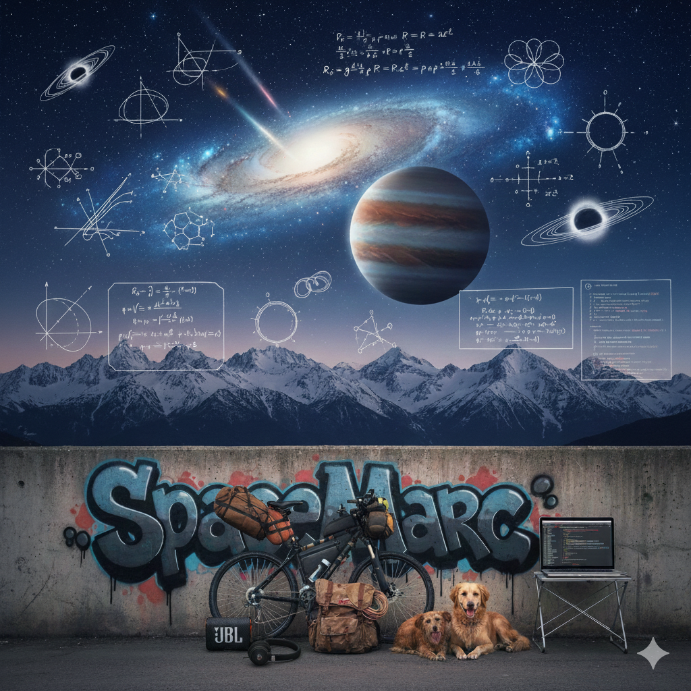

<!-- Banner / Divider -->

<h1 align="center">From Earth's core to the cosmos' edge, I speak in code and verse   🌍🪐🖖  :cyclone: :space_invader: </h1>

  <b>I'm Marc – Space Scientist, BI Analyst, and a storyteller of the cosmos.</b> 

  > _I grew up between mountains; now I work between cosmic rays and SQL queries, turning complexity into tools that actually help people._

<!-- Banner / Divider -->

## 🌌 Who am I?

- 🪐 <b>Space Scientist</b> with a B.Sc. in <b>Earth Sciences & Mathematics with a focus on Space Sciences</b> – School of Sciences, <a href="https://www.unam.mx">UNAM</a>.
- 🧮 Advanced self‑studying areas include: Measure Theory, Functional Analysis, PDEs, Sobolev Spaces, Riemannian Geometry, Geometric Statistics, Graph Theory, Topology, Manifolds, Topological Deep Learning, etc.
- 🛰️ Academic projects on <b>Cosmic Rays, Space Weather, and Geomagnetic Storms</b>, including numerical simulations with <b>CORSIKA</b> and analysis in <b>Python</b>.
- 📊 Currently working as a <b>BI Analyst</b>, building data models, reports, and dashboards to support business decisions.

> _I like to think of my path as a long ascent: slow at times, steep often, but always one more step forward._

---

## 🧠 What I work with

### 🔭 Data & Science

- 🐍 <b>Python</b>: NumPy, Pandas, SciPy, Matplotlib/Seaborn, Streamlit
- 🗄️ <b>Databases</b>: SQL, PostgreSQL, DBeaver
- 📊 <b>BI & Analytics</b>: Power BI, Excel & KPIs
- 🧪 <b>Statistics & ML</b>: Inferential statistics, hypothesis testing, regression, basic ML workflows
- 🌌 <b>Scientific Computing</b>: CORSIKA simulations for atmospheric particle showers, data analysis pipelines in Python

### 📐 Mathematics & Theoretical Interests

- Riemannian Geometry & Manifolds
- Measure Theory & Probability
- Functional Analysis & Quantum Computing
- Geometric Statistics & Topological Deep Learning
- Graph Theory & Graph Neural Networks (GNNs)

> _“The mathematician plays a game in which he himself invents the rules while the physicist plays a game in which the rules are provided by nature, but as time goes on it becomes increasingly evident that the rules which the mathematician finds interesting are the same as those which nature has chosen.” – Paul Dirac_

---

## 🚀 Selected highlights

- 🛰️ <b>Cosmic Ray Thesis</b> – Numerical simulations of cosmic rays interacting with the atmosphere using CORSIKA; analysis of secondary particle distributions with Python.
- ⚡ <b>Space Weather & Geomagnetic Storms</b> – Data analysis projects linking space‑weather events with geomagnetic indices and Earth impacts.
- 🧠 <b>Geometric Intelligence Workshop 2025 (UNAM × UC Santa Barbara)</b> – Worked on:
  - Topological Deep Learning & Graph Neural Networks
  - Geometric analysis on Riemannian manifolds
  - Interdisciplinary project on <b>brain connectomes for ADHD diagnosis</b>
- 📈 <b>BI & Data Analytics</b> – Dashboards and tools for:
  - Seismic activity analysis and historical earthquake distribution in Mexico
  - Exoplanet data exploration
  - Operational analytics with Streamlit apps + Power BI reports

> _Every project is an excuse to ask one more question and build one more tool._

---

## 🌐 Portfolio

> Here you will soon find my Streamlit portfolio with live apps and data stories.

- 🌍 <b>Streamlit Portfolio:</b> https://marc121mata-portfolio.streamlit.app
- 🛰️ Projects include: earthquake analytics, exoplanet explorer, space‑weather dashboards, and more.

---

## ⚙️ GitHub Analytics

  

---

## 💻 Tech stack

  

---

## 🧭 How I like to work

- 🧩 <b>Multidisciplinary thinking</b> – I enjoy combining physics, math, earth sciences, and data to see patterns others might miss.
- 🛠️ <b>Tools, not just theory</b> – I love turning abstract concepts into practical code, dashboards, or decision tools.
- 📚 <b>Self‑learning as a habit</b> – Most of my skills in Python, SQL, BI, and advanced math come from late‑night self‑study, courses, and lots of trial and error.
- 🌱 <b>Science outreach</b> – I create content about Planetary Science, Astrophysics, and Geosciences on Instagram (@space.marc_stjarnstoft).
- 🐕 <b>Resilience</b> – I didn’t take a straight path: I paused studies to work, then returned, and kept pushing for myself, my family, and my dogs.

> _I like code that tells the truth about the data and words that tell the truth about the code._

---

## 🌍 Languages

- English – Growing fast (technical and conversational)
- Russian – Self‑learning
- Swedish – Self‑learning
- Uzbek – Self‑learning

> _Learning languages is my way of extending the coordinate system of my mind._

---

## 🚵‍♂️ Outside the terminal

When I’m not staring at data or equations, I’m usually:

- 🚲 <b>Bikepacking</b> – Long rides with a small pack, chasing quiet roads, stars, and altitude gains.
- ⛰️ <b>Climbing mountains</b> – I grew up in the mountains, and I still look for summits whenever life gets noisy.
- 🎒 <b>Backpacking & slow travel</b> – Exploring places by foot, bus, and local food, moving light and staying curious.
- 🎧 <b>Rap head</b> – I love rap as storytelling: rhythm, wordplay, and honesty. The way a good verse hits is not that different from a clean proof or an elegant model.

> _The same mindset that gets me up a steep trail is the one that gets me through a hard bug or a dense paper: one step, one line, one more try._

> _I feel the fear, ‘cause life’s never sweet,  
I need money to survive, keep food on my seat.  
My hometown is distant, but I carry the flame,  
A skugga surrounds me, dröm calls your name._

---

## 🤝 Connect with me

  
  

  <b>I’m open to roles in Data / BI / Analytics, scientific computing, and research‑oriented projects.</b> 
  If you think my mix of <i>space science + math + data + resilience</i> can add value to your team or project, feel free to reach out.

  

